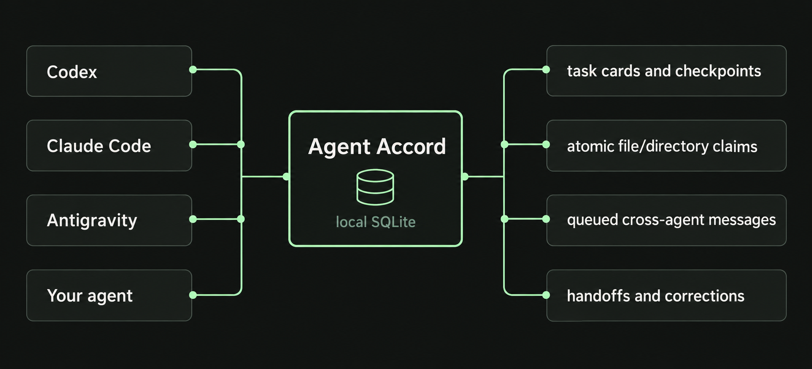

# Agent Accord

**One project. Multiple coding agents. A shared agreement on who is changing what.**

Agent Accord is a small, local work register for Codex, Claude Code,
Antigravity, and other coding agents sharing a Git working tree. Agents publish
short task cards, claim files before editing, checkpoint progress, and hand work
over with a record of what was verified. A portable coordination skill teaches
them the workflow.

It runs on Python's standard library and SQLite. No API keys, model provider,
external server, cloud account, or runtime Python dependencies are required.

**Want to see the work as it happens?** The local monitoring dashboard shows
agent activity, published cards, path ownership, and handoff evidence in your
browser. [Open the monitor](#monitoring-dashboard).

## Why it exists

Two agents can understand the same code perfectly and still overwrite each
other's work. Chat histories are separate; dirty files do not explain who owns
them; a message saying "I'm fixing it" does not identify the scope.

Agent Accord gives cooperating agents a common place to answer:

- Who is working on this project, and on what?
- Does another task own this file or directory?
- Are these existing edits authorized for me to continue?
- What was checked, what is blocked, and what remains for the next agent?



Claims are advisory. The CLI prevents conflicting claims in its register;
agents must follow the skill to prevent conflicting edits. It cannot stop an
editor, agent, or human that ignores the protocol.

## Quick start

Requirements: **Python 3.10+**, **Git**, and agents with terminal access to the
**same Git working tree**. Windows, macOS, and Linux are CI targets; see
[validation](docs/validation.md) for test coverage and verification details.

Clone Agent Accord, install the CLI, and initialize coordination in your project:

```sh
git clone https://github.com/shafikhw/agent-accord.git
cd agent-accord
python -m pip install .
agent-accord --root /path/to/your-project init
```

PowerShell example (quote paths containing spaces):

```powershell
git clone https://github.com/shafikhw/agent-accord.git 'C:\work\agent-accord'
Set-Location 'C:\work\agent-accord'
python -m pip install .
agent-accord --root 'C:\work\My Project' init
```

Use a virtual environment if your Python installation requires one. If the
console command is not on PATH, `python -m agent_accord` is equivalent.

For a **zero-install bootstrap**, run the source CLI directly:

```sh
python /path/to/agent-accord/src/agent_accord/cli.py --root /path/to/your-project init
```

For a new project, run `git init` in it first. `init` installs:

```text
your-project/
├── AGENTS.md                              # coordination block appended
├── .gitignore                             # /.agent-accord/ appended
├── Agent Accord Monitor.cmd               # double-click to open on Windows
└── .agents/skills/agent-accord/
    ├── SKILL.md                           # portable agent workflow
    ├── LICENSE                            # license travels with the copied runtime
    └── scripts/
        ├── coord.py                       # portable CLI
        ├── monitor.py                     # local read-only server
        └── monitor_assets/                # dashboard HTML, CSS, and JavaScript
```

Existing instructions and ignore entries are preserved. Identical installs
are no-ops. Differing skill/runtime files require an explicit `init --upgrade`
after reviewing them. An edited coordination block in `AGENTS.md` requires
manual reconciliation; it is never silently replaced. Installation preflights
conflicts, but an OS/filesystem failure can leave a partial install; rerun after
resolving that failure. The database is created on the first write operation.

After initialization, every agent can use the copied CLI without installing a
Python package. Run from **your project's root**:

```sh
python .agents/skills/agent-accord/scripts/coord.py status --agent codex --text
```

For team use, commit the generated skill, CLI, `AGENTS.md`, and `.gitignore` to
the target project after review. Keep `.agent-accord/` ignored. If your existing
ignore rules exclude `.agents/`, adjust those rules explicitly. Agent Accord
does not stage or commit files. Each clone starts with an empty local register.

## Monitoring dashboard

After `init`, **double-click `Agent Accord Monitor.cmd` in your project's root
folder** on Windows. It starts the monitor and opens your default browser.
Keep its terminal window open while monitoring; close it or press Ctrl+C to
stop. Python 3.10+ must be available on PATH (`python` or the Windows `py`
launcher). No package installation is needed to use the copied monitor.

On macOS, double-click the generated `Agent Accord Monitor.command`. On
Linux, run `./"Agent Accord Monitor.sh"` in a terminal, or open it through a
file manager configured to execute scripts. Launcher behavior depends on your
desktop's script execution settings.

You can also open it from any terminal:

```sh
agent-accord --root /path/to/your-project monitor
# Or, from the target project's root, without installing the package:
python .agents/skills/agent-accord/scripts/coord.py monitor
```

The dashboard includes:

- **Agent overview:** each identity's open-card count and latest published update.
- **Published cards:** filter by agent or status, search summaries and paths,
  and open full evidence, claims, session references, and corrections.
- **Ownership and attention:** counts of working cards, active/paused claims,
  paused or stale cards, and completed handoffs.
- **Recent activity:** card creation, the latest checkpoint, completions,
  corrections, and recent coordination messages.
- **Messages:** the latest 200 notes with their acknowledgement state. Viewing
  them never consumes an inbox.

It refreshes every three seconds and works without Internet access. It reads
the local register only; it cannot finish cards, release claims, or send notes.
Agent activity means **published checkpoints**, not process liveness or token
usage. Earlier checkpoint versions are not retained by the register. When the
connection fails, the last snapshot stays visible with a disconnected warning.

The monitor binds only to `127.0.0.1` and chooses an available port. Use
`monitor --port 8765` for a stable local bookmark, or `monitor --no-browser`
to print its URL without opening a tab. A bookmark works while that server is
running; the project launcher starts it again. Each launch starts a separate
local server. Nothing is published to a remote website.

For an existing installation, update your package/source checkout, review the
changes, then run `agent-accord --root /path/to/your-project init --upgrade`
to add the dashboard and launcher. If you use a custom store, pass it to the
monitor as well: `agent-accord --root /path/to/project --store /local/register.sqlite3 monitor`.
The double-click launcher uses the default project store.

## Give each agent the same protocol

The generated `AGENTS.md` points agents to the skill. Also add a short pointer
to any project instruction file your other tools actually load:

```text
Before editing, read .agents/skills/agent-accord/SKILL.md and use the shared
Agent Accord register. Use your own agent identity for task cards and inboxes.
```

For example, put that pointer in your project's `CLAUDE.md` for Claude Code,
and in the project instructions you configure for Antigravity. The installer
does not overwrite those tool-specific settings. Agent instruction discovery
differs by tool and version; opening the skill explicitly works with any agent
that can read files and execute the CLI.

See [agent setup and optional hooks](docs/integrations.md) for practical
configuration, parallel sessions, and a two-agent walkthrough.

## A normal work session

The examples use the installed `agent-accord` command. The copied
`python .agents/skills/agent-accord/scripts/coord.py` accepts the same arguments.

```sh
# 1. Read every agent's active ownership and your unread notes.
agent-accord status --agent codex --text

# 2. Open a task. Save the returned task_id.
agent-accord register --agent codex --summary "Fix CSV export rounding"

# 3. Replace TASK_ID with that ID; claim exact paths before editing.
agent-accord claim --task TASK_ID --path src/export.py --path tests/test_export.py

# 4. Checkpoint with actual evidence.
agent-accord update --task TASK_ID --summary "Rounding fixed; checking exports" --evidence "Focused tests passed"

# 5. Coordinate with the other agent when needed.
agent-accord message --task TASK_ID --to claude --text "Please review the export contract before changing the caller"

# 6. Finish only when this task is complete. Claims are then released.
agent-accord finish --task TASK_ID --summary "Fixed CSV rounding" --evidence "Export tests passed"
```

Any lowercase identity matching `[a-z][a-z0-9_-]{0,63}` works. For simultaneous
sessions of the same tool, use distinct identities such as `codex-api` and
`codex-ui` so inbox acknowledgements and routing are unambiguous. Messages are
cross-identity; a task cannot send to its own identity.

## Ownership rules that matter

| Situation | Behavior |
| --- | --- |
| Two processes claim the same scope | One succeeds; the other receives a conflict |
| A directory is claimed | Nested files and directories conflict |
| A batch contains one conflicting path | The entire batch is rejected |
| Existing staged, modified, untracked, or ignored work | Rejected unless the caller explicitly attests with `--adopt-existing` |
| A task reclaims a scope it already owns | Allowed, including its own subsequent edits |
| A task is paused or stale (15 minutes without an update) | Claims remain owned; staleness never expires ownership |
| A task is finished | Claims stop blocking; their history remains |
| A finished summary is wrong | Append a correction from a new task; preserve the original |
| A path escapes through `..` or a symlink | Rejected |

`--adopt-existing` is an ownership attestation after inspecting the work and
authorization. It does not override another task's claim. There is no force
takeover command. If an owner disappeared, ask the project owner to review the
task and finish it with an honest handoff summary before claiming its scope.

## Scope, privacy, and limits

- **Local to one working tree.** Separate clones, Git worktrees, machines, and
  containers with different path mappings have separate coordination state.
  A remote Git push does not share the register.
- **Use a local filesystem.** Do not use SQLite as a cross-machine sync service
  or put an active database on a network/cloud-sync mount. If your checkout is
  synchronized, use `--store` to choose an unsynchronized local path, and give
  every agent exactly the same root/store arguments. See [operations](docs/operations.md).
- **Summaries only.** The schema records task summaries, path claims,
  timestamps, optional session references, evidence, messages, and corrections.
  It does not ingest prompts, transcripts, source code, or file contents.
  It cannot prevent callers from pasting secrets into free-text fields.
- **No authentication boundary.** Anyone who can use the store can act on task
  IDs. Claims do not enforce filesystem permissions, approvals, or Git policy.
- **Messages are queued.** Delivery happens at the next status/inbox check;
  nothing starts or interrupts another agent. Acknowledgement is not agreement.
- **Evidence is self-reported.** Check the real diff and test output before
  relying on a handoff. Corrections are append-only through the CLI, not a
  tamper-proof audit log against direct database edits.

## Documentation

- [CLI reference](docs/cli.md): arguments, output, states, and examples.
- [Agent setup](docs/integrations.md): shared instructions, identities, hooks, walkthrough.
- [Design](docs/design.md): SQLite transactions, path scopes, root binding, and schema.
- [Operations](docs/operations.md): local stores, recovery, upgrades, and troubleshooting.
- [Validation](docs/validation.md): tests, verification boundaries, and release checks.
- [Contributing](CONTRIBUTING.md), [security](SECURITY.md), [changelog](CHANGELOG.md).

## Development

```sh
python -m pip install -e .
python -m unittest discover -s tests -v
python -m pip wheel . --no-deps
```

There are no runtime or test-framework dependencies. The CI workflow tests
Windows, macOS, and Linux with Python 3.10 and 3.13, then checks built-package
installation.

## Contributing

Bug reports, reproducible test cases, documentation improvements, and code
contributions are welcome. See [CONTRIBUTING.md](CONTRIBUTING.md) for the
development workflow and design expectations. For security-sensitive reports,
follow [SECURITY.md](SECURITY.md).

## License

[MIT licensed](LICENSE).
